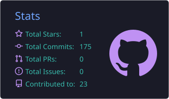

 

  

---

## About Me

I'm a **full-stack web developer in training** who builds modern, responsive web apps with **Next.js, React, TypeScript, Node.js and MongoDB**. I'm in the final stretch of Programming Hero's **AI-driven full-stack web engineering** program, and I'm now building real-world full-stack projects end to end: UI, auth, database and deployment.

Outside of code, I work as a **part-time Project and Social Media Manager at Halal Shoot**, where I manage projects, run social media for Halal Shoot and its client brands, and handle social media customer support. I'm also pursuing a **Bachelor's degree in Geography and Environment at Pabna University of Science and Technology (PUST)**. I'm passionate about technology, research and problem-solving, and I'm always eager to collaborate on projects where **web tech meets media**.

### The 30-Second Overview

| | |
|---|---|
| **Target role** | Full-Stack Web Engineer |
| **Core stack** | Next.js · React · TypeScript · Tailwind CSS · Node.js · Express · MongoDB · Better Auth · JWT |
| **Experience** | Project and Social Media Manager (part-time) at Halal Shoot |
| **Education** | B.Sc., Geography and Environment, Pabna University of Science and Technology |
| **Location** | Bangladesh |
| **Reach me** | [mhbsaim27@gmail.com](mailto:mhbsaim27@gmail.com) |

---

## My Featured Projects

| Project | What it does | Stack | Links |
|:---|:---|:---|:---|
| **🏝️ Tourism Spots of Feni District** | Static website showcasing tourism spots in Feni, Bangladesh. | HTML · CSS · Tailwind CSS | [🔗 Live](https://tourism-spots-of-feni.vercel.app) · [💻 Code](https://github.com/mhbsaim04/tourism-spots-in-feni) |
| **✈️ Wanderlast Travel Booking Webapp** | A full-stack website of travel booking platform where travelers can browse selected destinations, search for their next trip, and book travel packages instantly. The project is split into two applications: 1/ Frontend - a Next.js (App Router) website, 2/ Backend - a separate Express.js REST API that owns the MongoDB database and secures every booking and admin operation behind JWT authentication  | Next.js · React + TypeScript · Tailwind CSS v4 · better-auth + jwt plugin · Base UI (shadcn-style primitives) | [🔗 Live](https://wanderlast-travel-booking-webapp.vercel.app) · [💻 Code](https://github.com/mhbsaim04/wanderlast-travel-booking-webapp) |
| **🛒 Bazar Dor** | Bengali-language market-price dashboard for everyday products in Bangladesh. Shows price movers, category pages with sorting, and protected product pages with min, max, average and market-wise prices. Auth via email/password plus Google and GitHub OAuth. | Next.js App Router · React 19 · TypeScript · Tailwind v4 · Better Auth · MongoDB | [🔗 Live](https://bazar-dor-web-project.vercel.app/) · [💻 Code](https://github.com/mhbsaim04/bazar-dor-web-project) |
| **🏋️ FitLog** | Workout library and daily training planner. Includes a 12-workout library, a "Today's Plan" capped at five lifts, sorting by duration, calories and rating, and plan persistence across reloads. | Next.js 16 · React 19 · TypeScript · Tailwind v4 · Lucide · React Hot Toast | [🔗 Live](https://body-fit-log-web.vercel.app) · [💻 Code](https://github.com/mhbsaim04/body-fit-log-web) |
| **⚙️ Development Stack Web** | Programming Hero assignment: Build Your Ideal Development Stack. Explore frontend, backend, database, and tooling options, compare them side by side, and put together the stack that fits your next project.|  React · HTML · CSS  | [🔗 Live](https://development-stack-web.netlify.app/) ·  [💻 Code](https://github.com/mhbsaim04/dev-stack-web) |
| **🎤 DevConf 2026 Page** | Programming Hero assignment: conference event page. | HTML · CSS | [🔗 Live](https://mhbsaim04.github.io/PH-Assignment-01-DevConf-2026/) ·  [💻 Code](https://github.com/mhbsaim04/PH-Assignment-01-DevConf-2026) |

More: [servant-of-Allah-official](https://github.com/mhbsaim04/servant-of-Allah-official) · [tour-mama-official](https://github.com/mhbsaim04/tour-mama-official) · [all repositories →](https://github.com/mhbsaim04?tab=repositories)

---

## Technical Stack

  

<b>Beyond code: digital strategy and business skills (click to expand)</b>

 

- **Social media management:** content planning and coordination across a company brand and its client brands
- **Project management:** coordinating deliverables, timelines and stakeholders
- **Customer support:** handling social media inquiries and community communication
- **Sales and business case solving:** turning problems into practical, structured solutions
- **Design tools:** Canva for social media creatives

<b>Geography meets code (click to expand)</b>

 

My degree in Geography and Environment gives me a research-driven, data-aware way of thinking. I work with GIS and remote-sensing tools like **ArcGIS**, **QGIS** and **Google Earth Engine**. In my remote sensing academic proof-of-concept projects, I use my coding skills in Google Earth Engine. It connects my background in geography with technical scripting for spatial and data thinking.

---

## GitHub Stats

<!--Profile Summary Cards-->

<!-- contribution snake. --> 

<picture>
  <source media="(prefers-color-scheme: dark)" srcset="https://raw.githubusercontent.com/mhbsaim04/mhbsaim04/output/github-snake-dark.svg" />
  
</picture>

---

## Let's Work Together

I'm looking for opportunities to **build, learn and contribute** on real full-stack projects. If you're hiring, collaborating, or just want to talk **web development, open source or tech and media**, I'd love to hear from you.

